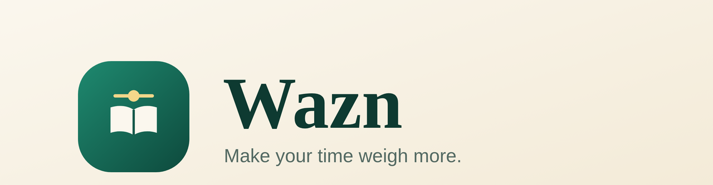

<div align="center">



<br/>


<p><strong>Turn doom-scrolling time into worship and remembrance.</strong><br/>
Wazn blocks distracting apps after a daily limit — and only unlocks them when you finish a reading or adhkar session.</p>

</div>

---

## 🎯 Why Wazn

> Every minute you read earns you **3 minutes** of browsing. Your time should *weigh* something.

Most screen-time apps are punitive. **Wazn** offers a fair trade: give a little worship (Quran, adhkar, reflection) → earn leisure time. The Mushaf, tafsir, adhkar, and the daily hadith all work **fully offline**.

## ✨ Features

- **📵 Smart blocking** — daily limit per app, gentle countdown, one daily snooze, a 30-second gradual block, and an emergency unlock (once/day).
- **📖 Built-in Mushaf** — Quran with tafsir on tap (Al-Muyassar), adjustable font & theme, full-screen reading.
- **📿 Adhkar & Tasbih** — morning/evening adhkar with a beautiful counter.
- **🕌 Daily hadith** — curated, with source and grade shown.
- **📊 Streaks & stats** — reading minutes, recovered time, weekly rest day that never breaks your streak.
- **🤝 Accountability partner** — share your streak only, never your screen time.
- **🌙 Offline-first** — everything religious works with zero network.
- **🌍 Arabic-first** — full RTL, native Arabic typography (Aref Ruqaa · IBM Plex Sans Arabic · Amiri).

## 🎨 Brand

| Token | Hex | Use |
|---|---|---|
| Emerald Night | `#07241F` | Dark surfaces |
| Emerald | `#0E3A31` | Primary |
| Oasis Green | `#1F6B5C` | Active states |
| Gold | `#E9C46A` | Primary action |
| Antique Gold | `#D4A24C` | Gradients |
| Sand | `#FBF7EE` | Light background |
| Warm Sand | `#F1E9D8` | Cards |
| Ink | `#10251F` | Text |

**Typography:** Aref Ruqaa (wordmark) · IBM Plex Sans Arabic (UI) · Amiri (Quran & hadith).

## 📱 Screens (25)

| Screen | File |
|---|---|
| Splash | `splash_screen.dart` |
| Onboarding · Apps & limit | `onboarding_apps_screen.dart` |
| Onboarding · Suggested defaults | `onboarding_defaults_screen.dart` |
| Home · next step | `home_screen.dart` |
| Block + snooze | `block_screen.dart` |
| Pre-block alert & widgets | `pre_block_alert_screen.dart` |
| Unlocked | `unlocked_screen.dart` |
| Worship · Mushaf | `worship_screen.dart` |
| Worship · Adhkar | `adhkar_screen.dart` |
| Dhikr counter | `dhikr_counter_screen.dart` |
| Reading · tap an ayah | `reading_screen.dart` |
| Reading · tafsir / themes / full-screen | `reading_screen.dart` (sheets) |
| Open intent | `open_intent_screen.dart` |
| Gradual block | `gradual_block_screen.dart` |
| Emergency unlock | `emergency_screen.dart` |
| Reflection after reading | `reflection_screen.dart` |
| Stats + rest day | `stats_screen.dart` |
| Settings | `settings_screen.dart` |
| Accountability partner | `accountability_screen.dart` |
| Permission off | `permission_screen.dart` |

## 🚀 Getting Started

```bash
flutter pub get

# Android / desktop
flutter run

# Web
flutter run -d chrome

# Release APK
flutter build apk --release
```

> **Requires:** Flutter 3.4+ · Dart 3.4+

## 🏗️ Architecture

```
lib/
├── main.dart              # entry · RTL · Provider
├── theme/                 # colors, theme, fonts
├── models/                # Ayah, Dhikr, Hadith, AppSettings
├── data/
│   ├── app_state.dart     # central ChangeNotifier state
│   ├── local_store.dart   # SharedPreferences persistence
│   └── seed_*.dart        # bundled offline data
├── widgets/               # logo, buttons, cards, bottom nav
└── screens/               # 20 screens
```

Every screen talks only to `AppState`, which reads from `LocalStore` before any network. Native Kotlin/Swift modules for real usage-time reading slot in behind that interface.

## 📦 Offline

| Works offline | Needs network |
|---|---|
| ✅ Quran + tafsir (bundled sample) | ⚠️ Prayer times |
| ✅ Adhkar + tasbih | ⚠️ Audio recitation |
| ✅ Daily hadith | |
| ✅ Streaks, stats, quota | |

## 🔮 Roadmap

- [ ] Full Quran archive (spa5k/tafsir_api) in SQLite
- [ ] Native Kotlin module (UsageStats) for real usage time
- [ ] Native Swift module (Screen Time / FamilyControls)
- [ ] Audio recitation with offline pre-download
- [ ] Accountability partner backend

## 📄 License

MIT © [Adham AbuElenin](https://github.com/domz-1)

<div align="center"><sub>Built with care — make your time weigh more ⚖️</sub></div>
